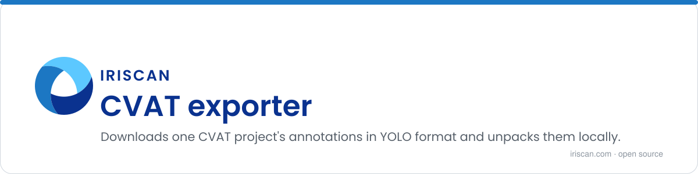

# CVAT exporter

A one-file Python script that downloads all annotations of one CVAT project in YOLO format and unpacks them next to the script. CVAT (Computer Vision Annotation Tool) is the open-source web tool used to label images and video for training computer vision models; YOLO is the plain-text label format that YOLO object detectors train on. Run this when you want the current labels of a project on your disk, ready for a training run.

## What it does

- Connects to a CVAT server with the official `cvat-sdk` using a username and password.
- Asks CVAT to prepare an export of the project's annotations in the `YOLO 1.1` format.
- Polls every 10 seconds until the archive is ready (up to 10000 tries), then downloads it as `annotations.zip`.
- Extracts the archive into the current folder.

## How to run

You need Python 3. The CVAT address, your credentials and the project ID are set at the top of `export.py`:

```python
configuration = Configuration(
    host='https://cvat.example.org',
    username='me',
    password='secret'
)
PROJECT_ID = '2'
```

Then:

```sh
pip3 install -r requirements.txt
python3 export.py
```

The script prints `Annotations successfully exported` and `Annotations successfully extracted` when it is done. If CVAT answers anything other than "accepted" or "created" while preparing the export, the script stops with the status it got.

## Related repositories

- [cvat_export_upload_s3](https://github.com/biometric-technologies/cvat_export_upload_s3): scheduled backup of completed CVAT tasks to S3-compatible storage, configured through a `.env` file.

## License

License: not yet specified.

## Contact

info@iriscan.net, https://www.iriscan.com
